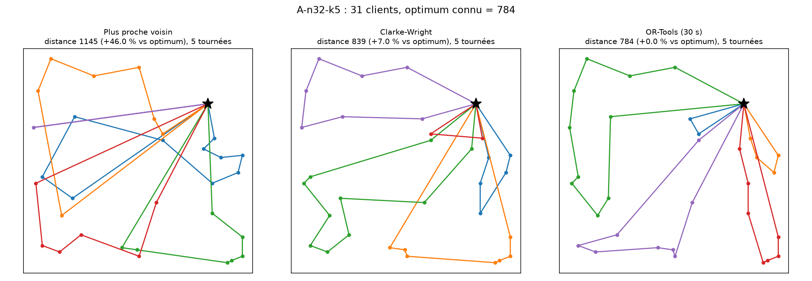

# Optimisation de tournées de livraison (CVRP)

Comparaison de trois méthodes de résolution du **Capacitated Vehicle Routing Problem** (CVRP) sur six instances benchmark de la littérature, avec un écart mesuré par rapport à l'optimum connu.

**Résultat principal :** sur six instances de 31 à 79 clients, OR-Tools (30 s par instance) s'écarte en moyenne de **1,0 %** de l'optimum, contre **4,4 %** pour l'heuristique de Clarke-Wright et **33,1 %** pour le plus proche voisin.



## Problème

Un dépôt, des clients avec chacun une demande, et une flotte de camions de même capacité. Il faut construire des tournées qui partent du dépôt et y reviennent, avec chaque client visité exactement une fois et la capacité jamais dépassée, en **minimisant la distance totale parcourue**. Le problème est NP-difficile.

## Données

Instances **Augerat et al. (1995), jeu A**, disponibles sur CVRPLIB : A-n32-k5, A-n39-k6, A-n45-k7, A-n54-k7, A-n63-k9, A-n80-k10. Le nom `A-n32-k5` signifie : jeu A, 32 nœuds (dépôt inclus), 5 camions. L'optimum de chaque instance est lu dans l'en-tête du fichier `.vrp`. Les distances sont euclidiennes arrondies à l'entier (convention TSPLIB `EUC_2D`), comme pour l'optimum publié.

## Méthodes

| Méthode | Principe |
|---|---|
| Plus proche voisin | Heuristique constructive : le camion va au client non visité le plus proche qui rentre dans sa capacité restante. |
| Clarke-Wright | Heuristique des économies (Clarke et Wright, 1964) : on part d'une tournée par client, puis on fusionne les tournées dont la fusion économise le plus de distance. |
| OR-Tools | Solveur de routage de Google : solution de départ (`PATH_CHEAPEST_ARC`) puis recherche locale guidée (`GUIDED_LOCAL_SEARCH`), limite de 30 s par instance. |

Toutes les solutions passent par un **vérificateur indépendant** (`verification.py`) qui contrôle que chaque client est visité exactement une fois, que chaque tournée commence et finit au dépôt, que la capacité est respectée, puis recalcule la distance.

## Résultats

Distance totale (écart à l'optimum entre parenthèses) :

| Instance | Clients | Optimum | Plus proche voisin | Clarke-Wright | OR-Tools (30 s) |
|---|---|---|---|---|---|
| A-n32-k5 | 31 | 784 | 1145 (+46,0 %) | 839 (+7,0 %) | 784 (+0,0 %) |
| A-n39-k6 | 38 | 831 | 1145 (+37,8 %) | 861 (+3,6 %) | 833 (+0,2 %) |
| A-n45-k7 | 44 | 1146 | 1428 (+24,6 %) | 1205 (+5,1 %) | 1146 (+0,0 %) |
| A-n54-k7 | 53 | 1167 | 1421 (+21,8 %) | **1174 (+0,6 %)** | 1191 (+2,1 %) |
| A-n63-k9 | 62 | 1616 | 2188 (+35,4 %) | 1681 (+4,0 %) \* | 1641 (+1,5 %) |
| A-n80-k10 | 79 | 1763 | 2348 (+33,2 %) | 1864 (+5,7 %) | 1797 (+1,9 %) |
| **Écart moyen** | | | **33,1 %** | **4,4 %** | **1,0 %** |

\* Clarke-Wright utilise 10 tournées au lieu des 9 annoncées : sa distance n'est pas directement comparable.

### Observations

- OR-Tools atteint l'optimum sur 2 instances sur 6 et reste à moins de 2,1 % sur les autres.
- Face à Clarke-Wright, OR-Tools réduit la distance de 3,2 % en moyenne (de 2,4 % à 6,6 %) et fait mieux sur 5 instances sur 6.
- Sur **A-n54-k7**, Clarke-Wright fait mieux qu'OR-Tools à 30 s. Cause non établie ; l'hypothèse d'un temps insuffisant sur cette instance très serrée (96 % de remplissage) reste à tester.
- Le plus proche voisin est très éloigné de l'optimum : en fin de parcours, il laisse des clients isolés qui partent seuls dans un camion presque vide (voir la figure).

## Limites

- Résultats d'**une seule exécution** par instance. OR-Tools s'arrête sur une limite de temps : les valeurs peuvent varier légèrement selon la machine et d'une exécution à l'autre.
- Six instances d'un seul benchmark : les résultats ne se généralisent pas à d'autres jeux ou à des données réelles.
- Modèle simplifié : une flotte homogène, des distances euclidiennes, pas de fenêtres de temps ni de trafic.

## Reproduire

```bash
pip install -r requirements.txt
python src/lecture.py            # vérifie la lecture des instances
python src/glouton.py            # plus proche voisin
python src/clarke_wright.py      # Clarke-Wright
python src/ortools_solveur.py    # OR-Tools (environ 3 min), écrit results/comparaison.csv
python src/visualisation.py      # figures des tournées dans results/
```

## Structure

```
data/        instances .vrp (Augerat, jeu A)
src/         lecture, glouton, clarke_wright, ortools_solveur, verification, visualisation
results/     comparaison.csv et figures des tournées
```

## Références

- Augerat, P. et al. (1995), instances du CVRP, jeu A, disponibles sur CVRPLIB.
- Clarke, G. et Wright, J. W. (1964), *Scheduling of vehicles from a central depot to a number of delivery points*, Operations Research.
- OR-Tools, Google : bibliothèque d'optimisation et de routage.